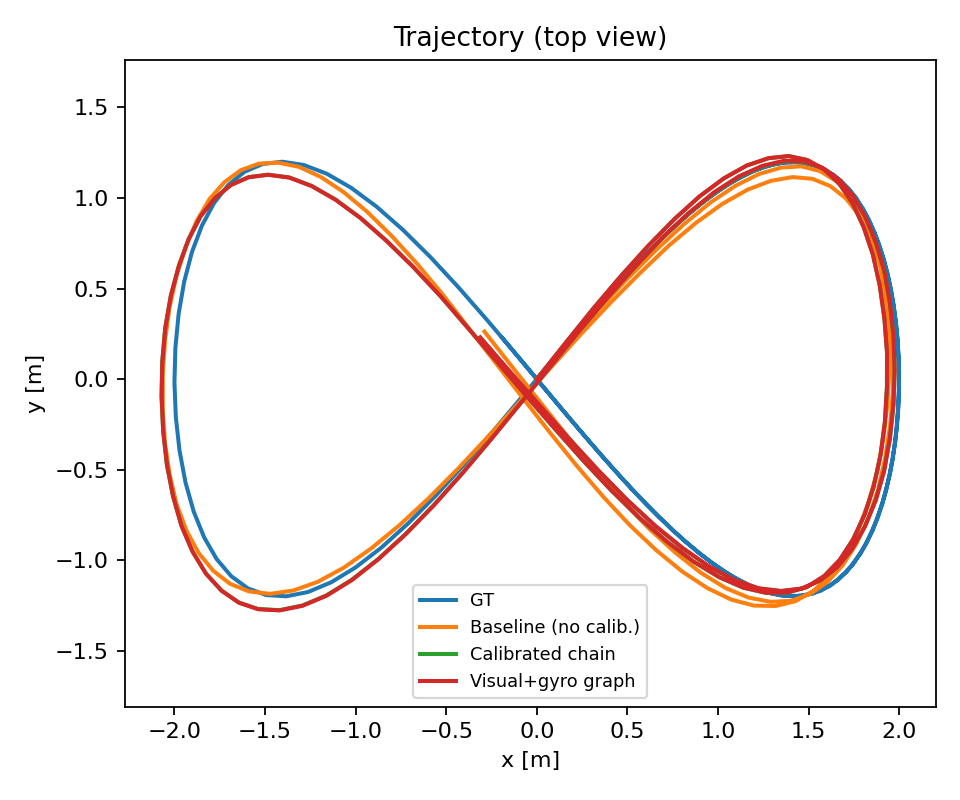
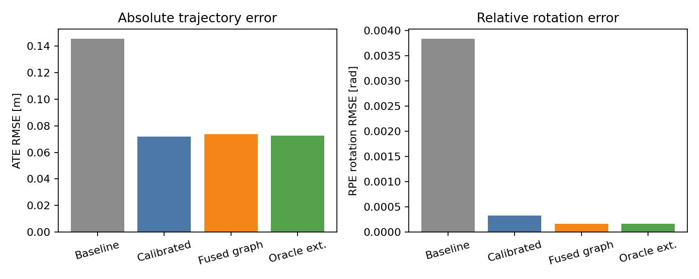

# VIO Camera–IMU Time-Sync / Extrinsic Calibration + Factor-Graph Pose Optimization

A small, reproducible **synthetic** prototype for the parts of a VIO pipeline that are hardest to demonstrate without a full SLAM stack:

- camera–IMU **time offset** and **extrinsic rotation** calibration;
- visual relative-pose + gyro-preintegration **factor graph** for body poses;
- **ATE / RPE** evaluation, baseline vs calibrated.

It is deliberately honest about scope: this is **not** a full VIO system, does **not** run VINS-Mono / ORB-SLAM3 / OpenVINS, and uses synthetic data rather than EuRoC.

## Results (120 keyframes, 12 s, IMU at 200 Hz, visual at 10 Hz)

| Metric | Baseline (no calibration) | Calibrated chain | Visual+gyro graph | Oracle extrinsic |
| --- | ---: | ---: | ---: | ---: |
| ATE RMSE [m] | 0.1455 | 0.0718 | 0.0735 | 0.0725 |
| RPE translation RMSE [m] | 0.01013 | 0.00527 | 0.00527 | 0.00522 |
| RPE rotation RMSE [rad] | 0.003839 | 0.000326 | 0.000163 | 0.000163 |

Calibration: true time offset 12.0 ms → estimated **11.90 ms** (0.10 ms error); extrinsic rotation error **0.038°**.




## Quickstart

```bash
conda env create -f environment.yml
conda activate vio-calib
python scripts/run_all.py
```

Outputs:

- `data/sim.npz` — synthetic trajectory, IMU, visual relative poses, ground truth;
- `data/calib.json` — time offset, extrinsic rotation, residuals;
- `results/metrics.json` — ATE/RPE table;
- `results/trajectory.png`, `results/metrics.png` — plots.

## Method

1. **Simulation** (`src/simulate.py`): smooth 3D figure-eight, body poses, IMU specific force/angular velocity, camera rigidly mounted with `T_bc`, visual relative poses between keyframes, IMU clock offset `dt`.
2. **Calibration** (`src/calibrate.py`): camera angular velocity from visual relative rotations; IMU angular velocity interpolated at the interval midpoint minus `dt`; least-squares over `R_bc` and `dt` (gyro bias assumed zero in this synthetic setup).
3. **Factor graph** (`src/factor_graph.py`): body poses + visual relative-pose factors + gyro-preintegration rotation factors; solved with `scipy.optimize.least_squares`.
4. **Evaluation** (`src/factor_graph.py`): Umeyama alignment, ATE RMSE, RPE translation/rotation RMSE.

## Limitations

- **Synthetic data**, no camera images or feature tracking; not EuRoC.
- **No accelerometer/velocity factors**; this is a rotation + visual pose graph, not a full VIO.
- **Camera-from-body translation is not estimated**; it is unobservable from visual relative poses alone (a constant right transform cancels in every relative pose). A full VIO needs IMU/velocity factors or absolute observations.
- **Python**, not C++; no real-time/embedded deployment.

## Why this project is relevant

It targets the parts of a VIO/VSLAM pipeline that are easy to claim but hard to prove: time synchronization, extrinsic calibration, factor-graph optimization, and trajectory evaluation. It is designed to be discussed honestly, including its boundaries.
